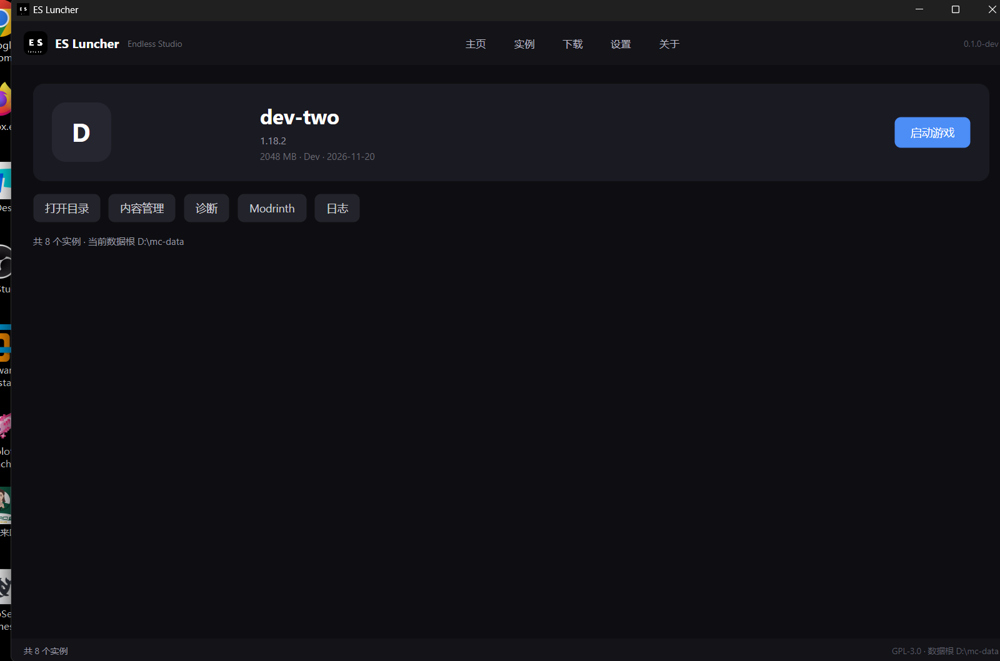
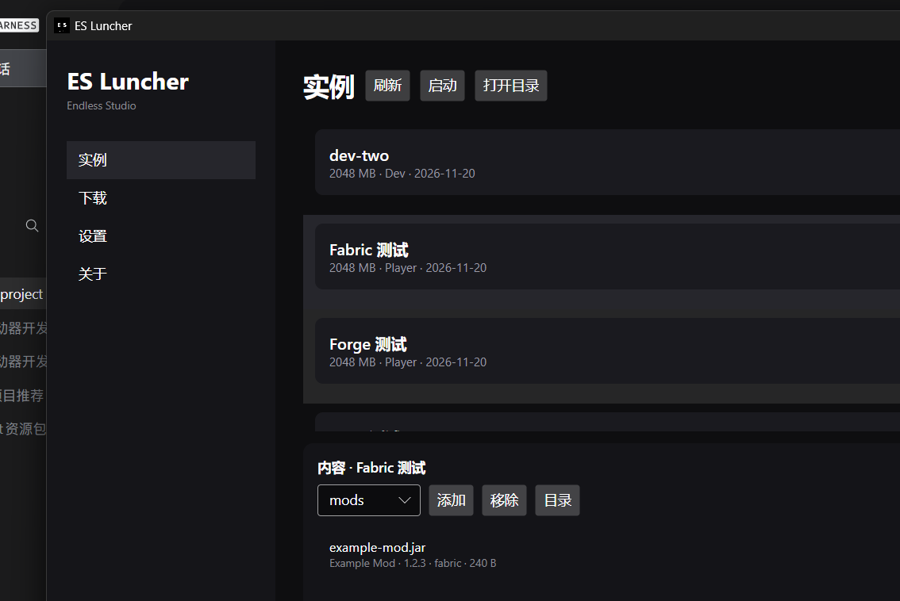
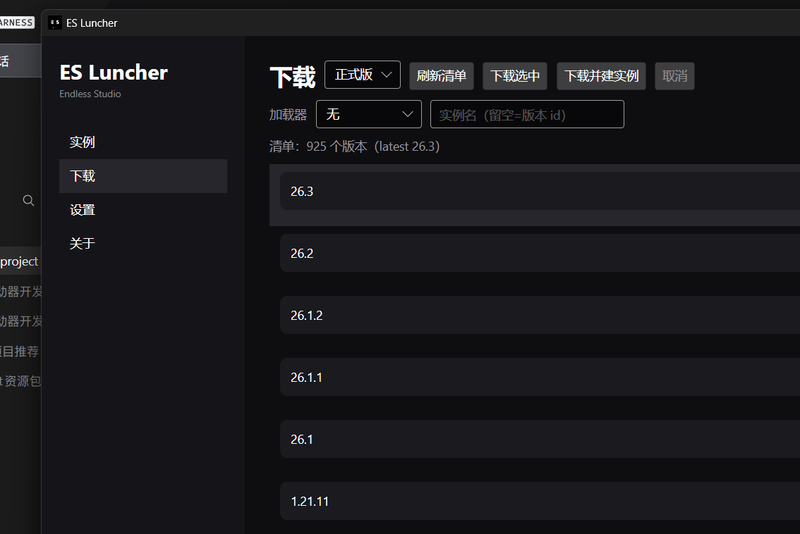
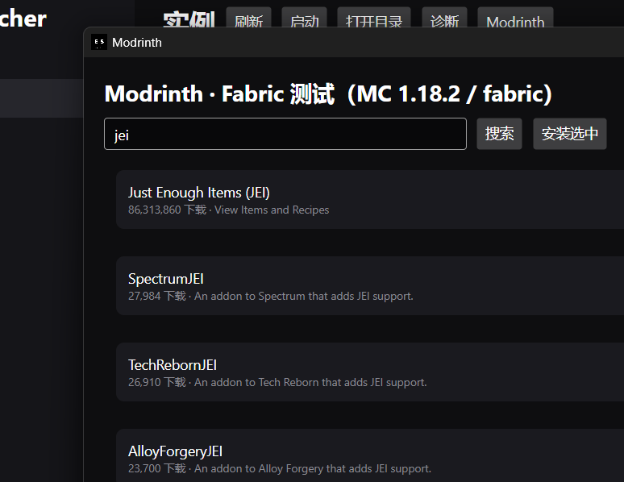
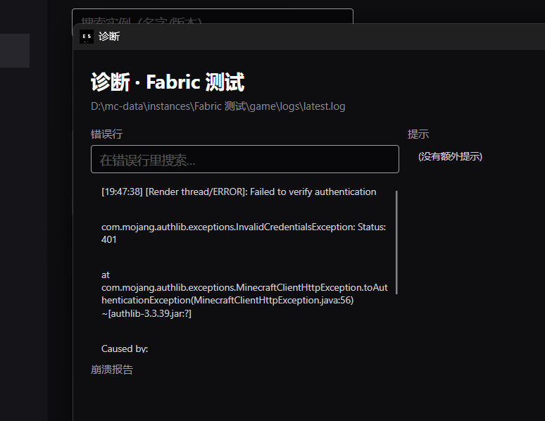

# ES Luncher

轻量、开源、无广告的 **Minecraft Java 版**桌面启动器（Windows 优先，架构跨平台）。

[](LICENSE)
[](https://dotnet.microsoft.com/)
[](https://avaloniaui.net/)
[](#运行要求)



## 它做什么

- **全版本下载**：Mojang 官方清单 → 版本 → 库 → 资源，逐个校验 SHA1；官方源失败自动回退镜像
- **Java 运行时自己管**：按版本元数据自动安装 Mojang 官方运行时，不要求你预装 JDK
- **实例系统**：同一份共享库/资源，多实例各自配置内存/Java/参数/窗口，可并行跑
- **加载器**：Fabric / Quilt / Forge（`inheritsFrom` 继承链正确合并；NeoForge 代码就绪但本机网络不可达，未验收）
- **内容管理**：mods / 资源包 / 光影 / 世界 / 数据包 / 截图，支持启用禁用、回收站式删除、本地添加、资源包排序
- **Modrinth**：检索、详情、按类型安装、整合包一键建实例；`.mrpack` 导入导出
- **诊断**：日志错误行、崩溃报告、人话提示、缺失前置补装、一键导出诊断包
- **自动更新**：Velopack 安装器 + 增量更新（实测增量包 87 KB，完整包 14 MB）

| 实例页 | 下载页 |
|---|---|
|  |  |

| Modrinth | 诊断 |
|---|---|
|  |  |

## 运行要求

- Windows 10 / 11 x64
- 安装版：自带运行时，**无需另装 .NET**
- 便携版（framework-dependent）：需要 .NET 10 Desktop Runtime

> 目前发布包**未做代码签名**，首次运行会被 SmartScreen 提示「未知发布者」。签名链路已就绪（见 `docs/CODE-SIGNING.md`），等真实证书。

## 安装

1. 从 Releases 下载 `ESLuncher-win-Setup.exe`（安装版）或 `ESLuncher-win-Portable.zip`（便携版）
2. 安装版装到 `%LOCALAPPDATA%\ESLuncher`；便携版解压即用
3. 首次启动：「下载」页选版本 → 下载并建实例 → 「实例」页启动
4. 更新：「其他」页 →「检查更新」

发布包附带 `SHA256SUMS-<版本>.txt`，可自行校验。

## 数据放在哪

| 内容 | 默认位置 |
|---|---|
| 游戏与实例数据 | `%APPDATA%\ESLuncher`（实例、库、资源、Java、日志） |
| 覆盖方式 | 环境变量 `ESLUNCHER_DATA` 或命令行 `--data <目录>` |
| 凭据 | `数据根\auth`，DPAPI 加密，存不了明文 |

不碰你自己的 `.minecraft`；只有你显式「导入其它启动器」时**只读**复制。

## 从源码构建

```powershell
git clone https://github.com/<owner>/es-luncher.git
cd es-luncher

dotnet build EsLuncher.slnx -c Release      # 零警告（TreatWarningsAsErrors 已开）
dotnet test  EsLuncher.slnx -c Release      # 204 个测试

# 一键验收（M0–M10，含一次真实启动回归）
powershell -NoProfile -File scripts\verify-acceptance.ps1 -WithUi -WithLaunch
```

出安装包（需要 `vpk`）：

```powershell
dotnet tool install vpk --tool-path D:\dev\tools\vpk
powershell -NoProfile -File scripts\pack-velopack.ps1 -Version 0.1.5
```

产物在 `artifacts\releases\`：Setup.exe、Portable.zip、full/delta nupkg、更新源索引。

## 项目结构

```
src/EsLuncher.Core   纯引擎：元数据解析、下载、Java、启动、加载器、认证、实例、内容、诊断、更新（零 UI 依赖）
src/EsLuncher.App    Avalonia 界面（壳）
src/EsLuncher.Cli    命令行验收面（fetch/launch/java/instance/content/modrinth/diagnose/update）
tests/               Core 单测 203 + Avalonia Headless UI 测试
docs/                事实源：里程碑文档、ADR、性能台账、打包与签名说明
scripts/             验活、验收、基准、打包脚本
```

想用 `EsLuncher.Core` 写自己的启动器？看 [`docs/DEVELOPER-GUIDE.md`](docs/DEVELOPER-GUIDE.md) 与 `samples/MinimalLauncher`。

## 状态

M0–M9 完成，M10（分发与增量更新）与 M11（性能）已交付：冷启动中位 **948 ms**、常驻 **112 MB**、下载 **1.62 MB/s**（1.7.10 assets 全量，含 SHA1 校验）。

进度与证据都在 [`PROGRESS.md`](PROGRESS.md)，路线图见 [`ROADMAP.md`](ROADMAP.md)，性能台账见 [`docs/M11-performance.md`](docs/M11-performance.md)。

## 贡献

见 [`CONTRIBUTING.md`](CONTRIBUTING.md)。安全问题请按 [`SECURITY.md`](SECURITY.md) 私下报告。

## 许可

**GPL-3.0-or-later**，见 [`LICENSE`](LICENSE)。第三方组件与其许可证见 [`NOTICE`](NOTICE)。

"ES Luncher" 与 "Endless Studio" 的名称、图标不随 GPL 授权。Minecraft 是 Mojang Studios 的商标，本项目与 Mojang / Microsoft 无关联。
