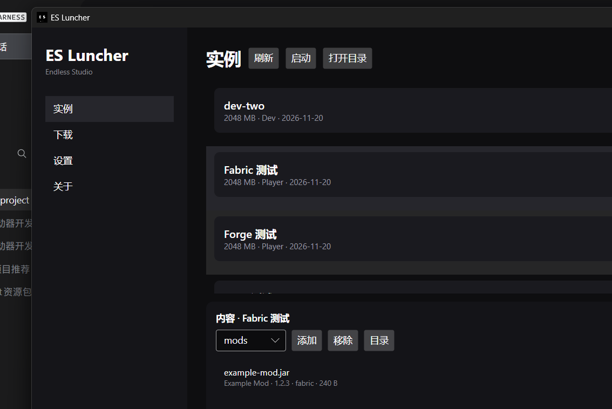
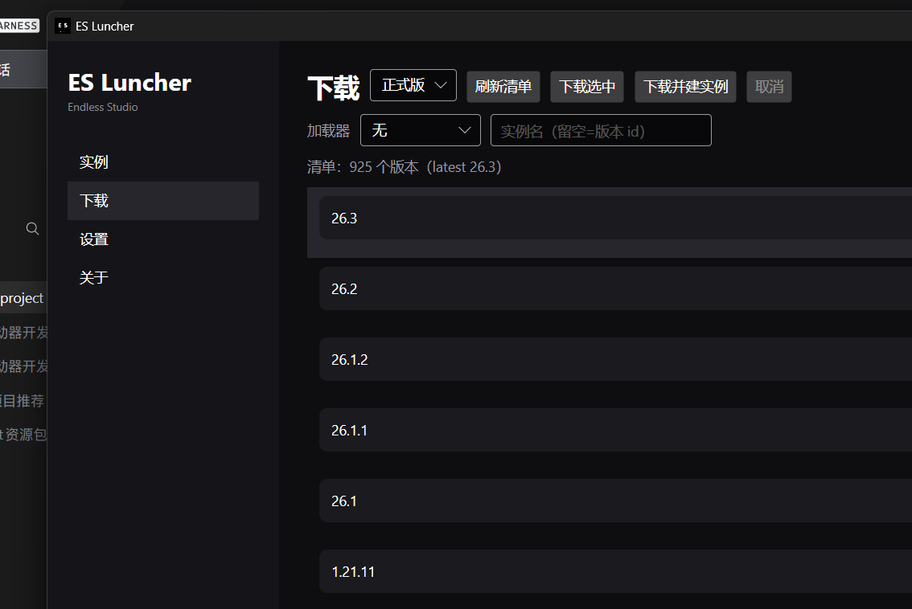
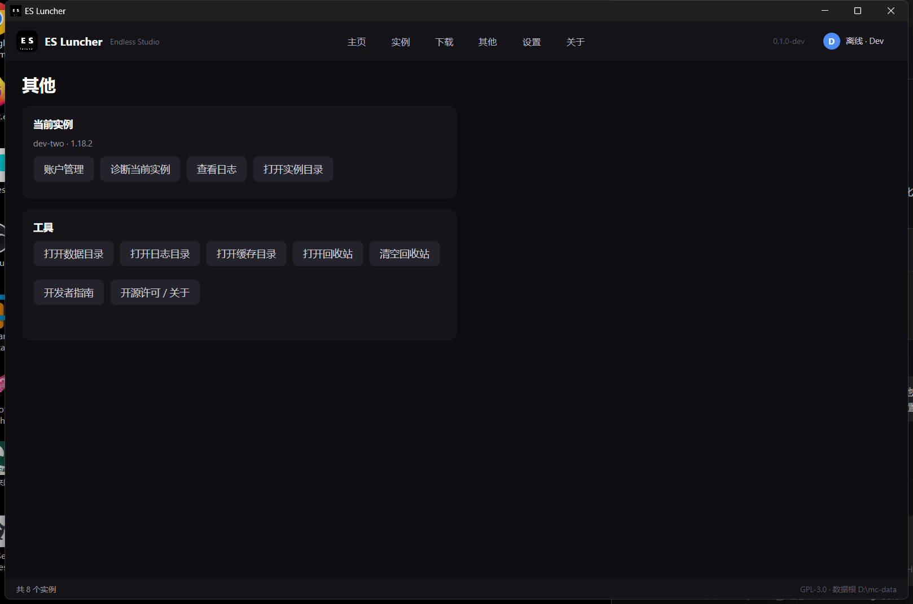
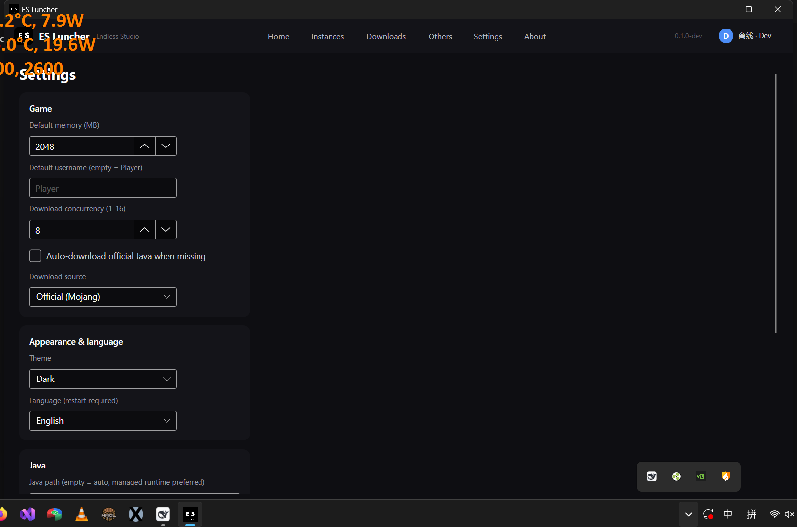

# M7 · 界面（进行中）

> 用户裁剪：图标**纯黑或纯白背景**，中部偏上大写 **ES**，下方 **luncher**；工作室（Endless Studio）的名称与图标**只出现在开发者/鸣谢页**。
> 本轮：图标 + UI 壳（实例页可用、关于页含工作室信息、下载/设置占位）。

## 1. 图标

| 文件 | 用途 |
|---|---|
| `assets/icon/es-luncher-dark-1024.png` / `-256.png` / `.ico` | 黑底白字（默认） |
| `assets/icon/es-luncher-light-1024.png` / `-256.png` / `.ico` | 白底黑字（浅色备用） |
| `scripts/gen-icon.ps1` | 可复现的生成脚本（System.Drawing，PS 5.1） |

- 视觉：纯黑/纯白背景；**ES** 用 Segoe UI Black，块面略高于中心；**luncher** 小写、宽字距，位于 ES 下方。
- 应用：`ApplicationIcon`（exe 图标）+ 窗口 `WindowIcon`（`avares://EsLuncher/Assets/…`）。

## 2. UI 壳（M7 第一刀）

- 左侧导航：**实例 / 下载 / 设置 / 关于**；底部 GPL 与版本。
- 实例页：读取 `InstanceStore`（真实数据），显示名称/版本/内存/账号/创建日期；**启动**按钮走 `LaunchService`（解析继承链 → 选 Java → 组命令 → 补 natives → 写日志），状态行回显进度与退出码；**打开目录**用资源管理器。
- 关于页：Endless Studio 图标 + 名称 + GPL/版本 + 里程碑摘要（工作室信息仅在此页出现）。
- 深色 Fluent 主题，窗口 1120×720。

## 3. 验收记录（2026-11-20）

| 项 | 结果 |
|---|---|
| 构建 | 0 警告 / 0 错误 |
| 窗口启动 | 标题 "ES Luncher"，尺寸 1134×758（含边框），进程存活 |
| 实例列表 | 真实读到 5 个实例（dev-two / Fabric 测试 / Forge 测试 / Quilt 测试 / 克隆 实例） |
| 截图 | `docs/img/m7-instances.png` |
| 启动按钮 | 已接线到 `LaunchService`（同一编排在 CLI 已验证）；**未做点击级自动化** |

## 4. M7 第二刀（下载页 / 设置页 / 关于页）

| 页面 | 能力 | 说明 |
|---|---|---|
| 下载 | 版本清单（925 条，正式/快照/全部筛选）、刷新清单、下载选中（进度条 + 文件数/字节 + 取消） | 复用 `VersionFetcher`/`DownloadExecutor`；实际下载走同一套 SHA1 校验 |
| 设置 | 数据根展示、默认内存、Java 路径、深/浅主题、保存 | `LauncherSettings` 落盘 `launcher-settings.json`；主题保存即生效 |
| 关于 | Endless Studio 图标+名称、GPL、版本、里程碑摘要 | 工作室信息仅此页出现 |

- 验收：构建 0 警告、**134 tests 全绿**；三个页面均实机截图（`ESLUNCHER_UI_PAGE` 作为验收入口，仅开发用）。
- 修掉的坑：XAML 加载期 `IsSelected` 先触发、命名控件尚未赋值 → `OnNavChanged` 空引用；内联 `IsSelected` 会在构造后再改回"实例"页 → 去掉内联选中，统一在构造里设置。

## 5.5 大改版：对标 PCL2/HMCL 的布局（2026-11-20）

- **顶栏导航**：Logo + ES Luncher + 主页/实例/下载/设置/关于（替代左侧栏）
- **主页（2026-11-20 重做）**：
  - 背景为实例展示：按实例名生成的渐变 + 超大首字母水印 + 底部渐隐
  - 右下角两行：第一行**实例名 + ▲**（点击弹出实例列表可直接切换），第二行**「启动游戏」**大按钮
  - 下方小字：版本 · 内存 · 分组
  - 去掉了原先的最近实例卡片、快捷操作行和统计文字
- **实例页**：2 列卡片网格（首字母图标/名字/版本/分组）+ 搜索/分组；右侧 430px 固定内容面板（类型、增删、启停、下载、检查更新、备份世界）
- **样式**：`Button.primary`（蓝）/`Button.ghost`（灰）/`Button.nav` 三套，卡片圆角 12，状态栏底部常驻
- 保留全部既有功能与验收钩子（`ESLUNCHER_UI_PAGE=home|instances|downloads|settings|about`）

### 账户登录（UI，2026-11-20）

- 「账户」窗口：列出已保存账户（名字/类型/当前实例标记），**使用**（绑定到当前实例）、**删除**
- 账户头像：优先从 crafatar 取皮肤头（`id` 是真实账号 UUID 时），失败回退首字母
- **添加离线账户**：输入名字即保存（DPAPI）
- **微软登录（设备代码）**：显示验证 URL + 代码，等待授权；需要 `ESLUNCHER_MSA_CLIENT_ID`（Azure 公共客户端）
- 「取消等待」可中断微软授权轮询

### 其他页 + 设置扩展（2026-11-20）

- 顶栏新增「其他」：账户管理、诊断当前实例、查看日志、打开实例目录；工具区：打开数据/日志/缓存/回收站目录、清空回收站、开发者指南、开源许可/关于
- 设置页对标 HMCL 分区：
  - 游戏：默认内存、默认用户名（新建实例用）、下载并发 1-16、缺 Java 自动下载
  - 外观与语言：深/浅色、中文/英文
  - Java：路径、托管运行时列表、打开 Java 目录
  - 数据：数据根、打开数据目录/回收站
- 新设置已接到行为：新建实例使用默认用户名与内存、下载并发使用设置值

### 第二批（下载/设置/账户/最近实例，无动画）

- **下载页改为分页**：`游戏版本 / 整合包 / 模组 / 资源包 / 光影 / 数据包` 六个 Tab
  - 顶部统一「目标实例 + 世界（数据包）」上下文，自动推导 MC 版本与加载器
  - 模组/资源包/光影/数据包：**打开即浏览**（空查询 + 默认下载量排序）、分类/排序下拉、详情窗、一键安装
  - 整合包：搜索 + 填实例名 + 直接建实例（`ModrinthDownloadPanel` 复用）
- **主页最近实例**：横向卡片，点击直接切换选中实例
- **账户栏**：顶栏右侧头像 + 名称（离线/已保存账户），点击打开「账户」窗口列出已保存账户
- **设置页**：分区卡片（常规 / 外观与语言 / Java / 保存）
- 全部静态样式，无动画、无过渡

### 打磨细节

- 窗口 1280×800（最小 1000×640），实例工具栏与搜索框分行，长内容不再挤出窗口
- 实例**搜索框**（名字/版本过滤）+ **分组下拉**（`instance group <名字> <分组>`），卡片显示分组
- 关于页补第三方组件（Avalonia MIT / .NET 10 MIT）与构建信息
- 设置页加「打开数据目录」与「语言（中文/English，重启生效）」
- 诊断窗错误行支持**搜索过滤**、自动换行；窗口加高保证底部按钮可见
- 内容面板按类型显示按钮（检查更新 / 备份世界 / 上移下移），不再堆一排无关按钮

### 关于页 · 鸣谢表

- 上方：工作室图标 + **Endless Studio**（按约定只在关于页出现）
- 下方：**开发者 / 鸣谢** 表（名字 / 角色），数据来自 `src/EsLuncher.App/Assets/credits.json`
- 当前名单：`AMXL_`（开发者）、`大肥鱼`（AI 助手）
- **可扩展**：直接编辑 `credits.json` 增删条目并重新构建，不需要改代码

### i18n 基础框架

- `Localization.T(key)` + 中英词表；覆盖导航、实例工具栏、搜索占位、标题
- 语言存 `launcher-settings.json`，重启生效；`ESLUNCHER_LANGUAGE=en` 可直接覆盖（验收用）
- 其余页面文案仍是中文：加词条只需在 `Localization.cs` 补一行并替换控件

## 6. 关于页重做 · 实例页布局纠正 · 懒加载（2026-11-21）

### 关于页（抽成 `AboutView`，首次打开才创建）

四张卡，按信息密度从高到低：

| 卡片 | 内容 |
|---|---|
| 运行环境 | .NET 版本与架构、操作系统、数据目录、安装形态（安装版 / 开发态） |
| 第三方组件 | Avalonia、.NET 运行时、Velopack 的版本**运行时现读**；xunit / Test.Sdk / coverlet 标注「仅测试，不随产品分发」并写死版本 |
| 数据与服务 | Mojang 清单与资源、Mojang Java 运行时、Microsoft OAuth、Modrinth、BMCLAPI、Crafatar、Fabric/Quilt Meta、Forge/NeoForge 安装器，各配一句用途 |
| 鸣谢 | 名单来自 `Assets/credits.json`，可直接编辑 |

- 标题由「开发者 / 鸣谢」改为 **「鸣谢」**，不再使用「开发者」字样；条目改写为「项目发起 · 设计与决策」「AI 编程助手 · 实现与文档」。
- 工作室信息（Endless Studio）只出现在本页：版本行「版本 x.y.z · Endless Studio · GPL-3.0-or-later」。
- 名单位置提示、无数据上传声明都写在页内。

### 实例页布局纠正

| 问题 | 修法 |
|---|---|
| 搜索行与列表用 `Margin="0,54"` 硬凑，缩放/换字体就重叠 | 改成 `RowDefinitions="Auto,Auto,*"`：标题行 / 搜索行 / 列表行各占一行；内容面板 `RowSpan=2` 直接贴住 |
| 卡片固定 `300×96`，长实例名被裁、分组挤成第三行 | 卡片宽 288、高度自适应；正文两行：名字 + 「版本 · 内存 · 账号 · 日期 · 分组」 |
| 没有实例时是一块空白 | 新增空态：提示 + 「去下载页」按钮 |
| 页面没有总量信息 | 标题下新增「显示 N / M 个实例」 |
| 工具栏按钮缺无障碍名称 | 刷新 / 打开目录 / 诊断 / 日志 / 启动 全部补 `AutomationProperties.Name` |
| 右侧面板列宽 430 且无列间距 | 396 + `ColumnSpacing=16`，与卡片留白一致 |

### 懒加载（与 `M11-performance.md` §5 对应）

`DownloadsView` / `SettingsView` / `AboutView` 改为 `ContentControl` 宿主 + 首次导航时创建，启动时不再解析这三页的 XAML。
冷启动中位数 **1306 → 948 ms**，常驻内存 **124.6 → 112.1 MB**。

## 7. M7 待办（剩余）

1. 下载页：加载器选择（Fabric/Quilt/Forge）与安装后实例化。
2. 设置：默认内存/Java 路径写入实例创建默认值；语言切换（i18n）。
3. 视觉：高 DPI 验证、16/32 图标清晰度、主题色 token 化。
4. 无障碍：键盘可达、对比度、屏幕阅读器标签。
5. 关于页：已补第三方许可清单与构建信息（2026-11-21）。
6. 启动按钮点击级自动化（可用 Avalonia Headless 或 UI 自动化补）。
