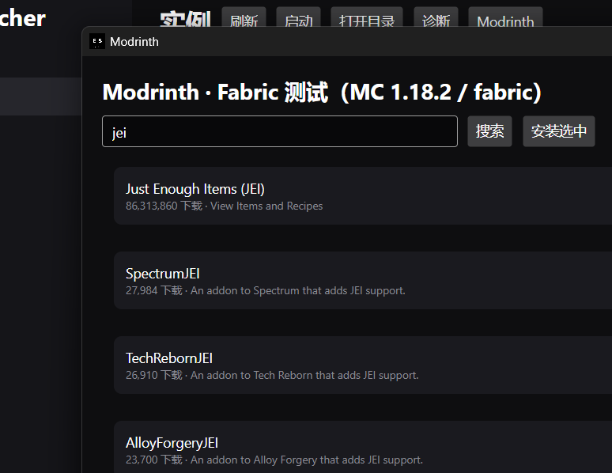
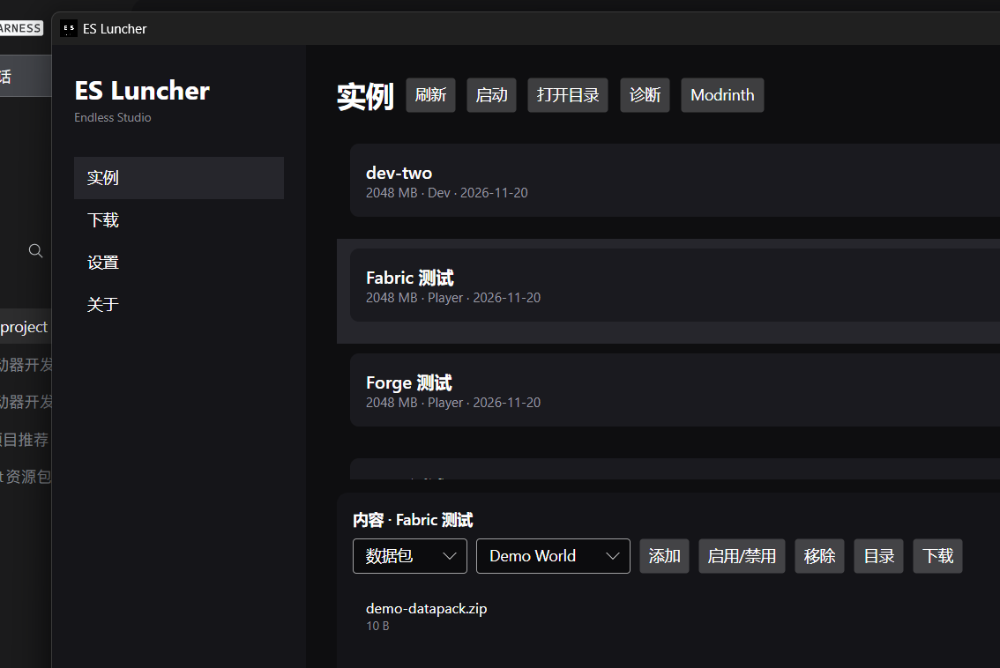
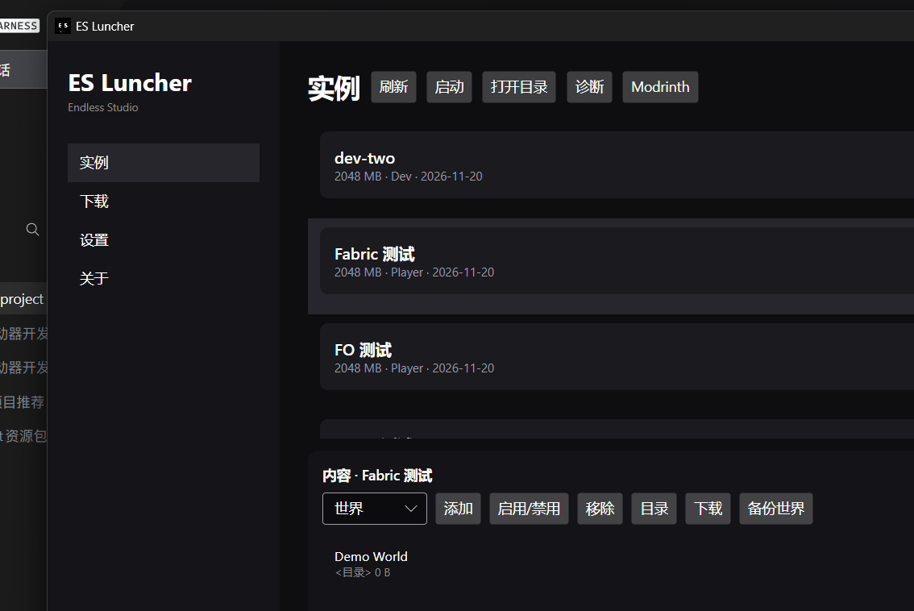

# M8 · 内容管理（进行中）

> 目标：mods / 资源包 / 光影包的安装、列出、移除；不破坏用户文件。
> 本轮：Core 服务 + CLI；UI 面板留给下一刀。

## 1. Core（`Content/InstanceContent.cs`）

| 能力 | 说明 |
|---|---|
| `ContentKind` | `Mods` / `ResourcePacks` / `ShaderPacks`，目录 `mods` / `resourcepacks` / `shaderpacks` |
| `List` | 返回文件名、大小、修改时间（不读 jar 元数据，先保持轻量） |
| `Add` | 复制进实例目录（同名覆盖），源文件不存在直接报错 |
| `Remove` | **移入 `数据根/trash/content/<实例>/<时间戳>-<文件名>`**，不真删；可手动找回 |

**为后续功能留的口子（别做死）**：

1. 加新内容类型：`ContentKind` 加枚举 + `FolderName` 映射即可，不需要改调用方。
2. `List` 返回 `ContentFile` 记录，将来可加 `ModId/Version/Dependencies` 字段而不破坏现有调用。
3. 删除是"复制到回收站 + 列表隐藏"，将来要做"还原/清空回收站"只需读 trash 目录。
4. 依赖解析/冲突检测将来放独立服务，读同一批文件，不动 `InstanceContentService` 语义。

## 2. CLI

```powershell
esluncher content list   --instance "Fabric 测试" --kind mods
esluncher content add    --instance "Fabric 测试" --kind mods D:\downloads\jei.jar
esluncher content remove --instance "Fabric 测试" --kind mods jei.jar
```

## 3. 验收记录（2026-11-20）

| 项 | 结果 |
|---|---|
| 测试 | **148 passed / 0 failed**（内容 10 个 + 模组元数据 4 个 + 其余） |
| 实测 | `content add` → 240 B jar 落 `instances\Fabric 测试\game\mods`；`list` 显示；`remove` 后列表为空，文件在 `trash\content\Fabric 测试\<时间戳>-example-mod.jar` |
| 安全 | 路径穿越（`../escape.jar`、`a/b.jar`）被拒；未知实例被拒 |
| UI | 实例页底部「内容」面板：类型切换 / 添加（文件选择器）/ 移除 / 打开目录；mods 自动读元数据（`Example Mod · 1.2.3 · fabric · 240 B`） |
| 元数据 | `fabric.mod.json` → id/name/version/depends；`META-INF/mods.toml` → modId/version/displayName；坏 jar 不抛异常 |

## 4. 模组元数据（`Content/ModMetadata.cs`）

- Fabric：解析 `fabric.mod.json`，依赖取 `depends` 里除 `minecraft/fabricloader/java/fabric-api` 之外的条目。
- Forge/NeoForge：轻量解析 `META-INF/mods.toml`（`[[mods]]` 块 + `[[dependencies.*]]` 的 modId），不引第三方 TOML 库。
- 解析失败/非模组 jar → `unknown`，UI 显示 `—`，绝不因坏 jar 崩溃。

## 6. Modrinth + .mrpack（2026-11-20 本轮）

| 能力 | 落点 | 证据 |
|---|---|---|
| Modrinth 检索 | `Content/ModrinthClient.cs` | `modrinth search --query jei --version 1.18.2 --loader fabric` → JEI 86,313,860 下载等 5 条 |
| Modrinth 安装 | 同上 | `modrinth install --instance "Fabric 测试" jei` → `jei-1.18.2-fabric-10.2.1.1002.jar`（1.1 MB） |
| 依赖实况 | —— | 先只装 JEI → 启动失败（`HARD_DEP fabric`）；装 `fabric-api` 后启动成功：**`Loading 51 mods`**、JEI atlas 创建 |
| `.mrpack` 导出/导入 | `Content/InstancePackService.cs` | 导出 971,964 B；导入到同版本实例：下载 0 / 覆盖 1 / 跳过 0 |

- 导出用 `overrides/mods/*`（不编造下载 URL）；导入支持 `files[].downloads` + `overrides/*`。
- 加载器名映射：实例 id 的 `fabric-loader` → Modrinth 的 `fabric`；`quilt-loader` → `quilt`。
- 路径穿越防护：包内 `../` 直接拒绝（单测 + 真实）。

### UI



- 实例页工具栏「Modrinth」→ 弹窗按当前实例的 MC 版本 + 加载器检索，选中后直接安装到 mods。
- 实测检索 `jei` → 4+ 条结果（JEI 86,313,860 下载）；安装后与 CLI 同一落盘路径。

## 8. 内容管理器扩展（2026-11-20）



| 能力 | 说明 |
|---|---|
| 内容类型 | **mods / 资源包 / 光影 / 世界 / 数据包** |
| 世界 | `saves/<世界>` 目录；列出、添加（目录选择器）、移除（回收站） |
| 数据包 | `saves/<世界>/datapacks`；界面有世界下拉，CLI 需 `--world <世界>` |
| 启用/禁用 | 文件或目录改名加/去 `.disabled` 后缀（不改内容）；世界不支持 |
| 删除 | 统一移入 `trash/content/<实例>/<时间戳>-<名字>` |
| 从 Modrinth 下载 | 按类型走 `project_type`：mod / resourcepack / shader / datapack，装到对应目录 |
| 本地添加 | 文件选择器（mods/资源包/光影/数据包）或目录选择器（世界） |

CLI：

```powershell
esluncher content list    --instance "Fabric 测试" --kind worlds
esluncher content list    --instance "Fabric 测试" --kind datapacks --world "Demo World"
esluncher content enable  --instance "Fabric 测试" --kind mods jei-....jar
esluncher content disable --instance "Fabric 测试" --kind mods jei-....jar
esluncher modrinth search  --query complementary --kind shaders
esluncher modrinth install --instance "Fabric 测试" --kind shaders --version 1.18.2 complementary-reimagined
```

实测：JEI 禁用→列表显示 `[禁用]`→启用恢复；添加 `Demo World` 世界；数据包落到该世界；资源包/光影各 1 个；Modrinth 光影安装 `ComplementaryReimagined_r5.10.zip`（567 KB）。

> 约定说明：`.disabled` 是启动器层面的启用/禁用约定（MC 不加载非 zip 资源包，Iris 也不加载 .disabled 光影），改名可逆。

### 整合包下载安装（2026-11-20）

```powershell
esluncher modrinth search --query fabulously --kind modpacks --version 1.18.2
esluncher modrinth modpack --instance "FO 测试" fabulously-optimized --version 1.18.2 --dry-run
esluncher modrinth modpack --instance "FO 测试" fabulously-optimized --version 1.18.2
```

实测 Fabulously Optimized（1.18.2）：

```
整合包依赖：MC 1.18.2, 加载器 fabric-loader 0.19.3
整合包入库：下载 43，覆盖 60，跳过 0
已创建实例 FO 测试 ← fabric-loader-0.19.3-1.18.2
mods：46 个
```

> 该整合包自带 Crash Assistant，首次启动它会弹出独立窗口；这是第三方行为，与启动器安装链路无关。其余 46 个 mod 与 Fabric 0.19.3 由本启动器装齐。

## 10. 世界 / 截图 / 更新 / 导入（2026-11-20 第二批）



| 能力 | CLI | 实测 |
|---|---|---|
| 世界列表/体积 | `world list --instance` / `world size` | Demo World 0.0 MiB（示例） |
| 世界备份 | `world backup --instance <n> <世界> --out <zip>` | `demo-world.zip` |
| 世界还原 | `world restore --instance <n> <zip> --world <新名>` | 还原为 `Demo World Restored` 并可重命名 |
| 世界重命名 | `world rename --instance <n> <旧> <新>` | `Demo World Restored → Demo World 2` |
| 截图浏览 | `content list --kind screenshots` + UI「截图」类型 | 支持查看/删除（回收站） |
| 模组更新检测 | `content outdated --instance <n>` | Fabric 测试：2 个模组均「已是最新」 |
| 模组一键更新 | `content update --instance <n>` | 旧文件进回收站 |
| 实例体积 | `instance size <名字>` | `FO 测试: 游戏目录 69.4 MiB` |
| **导入其它启动器内容** | `instance import-dir <名字> --source <目录> --version <id>` | 复制 mods/saves/config/options.txt，**源目录只读** |

- 版本比较是启发式：去掉 `1.18.2-` 前缀后比较字母数字，避免 MC 前缀造成假更新。
- 更新/补装都只动 mods 目录，旧文件一律进回收站。

## 9. 待办（M8 剩余）

1. jar 内依赖版本范围与冲突提示（当前只列 id）。
2. Modrinth 检索/下载、`.mrpack` 导入导出、CurseForge（需 API key）。
3. 资源包/光影包的启用/禁用（`disabled` 后缀或移动目录）。
4. 内容列表排序/搜索与批量操作。
