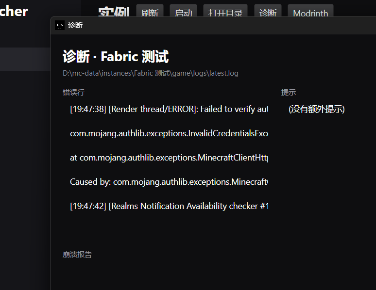

# M9 · 诊断能力（进行中）

> 目标：出问题时给玩家看得懂的提示，并能一键打包给作者。
> 本轮：诊断 Core + CLI + 诊断包导出；UI 入口下一刀。

## 1. 能力（`Diagnostics/InstanceDiagnostics.cs`）

| 能力 | 说明 |
|---|---|
| 错误行 | 读 `game/logs/latest.log` 最后 4000 行，抓 `ERROR]` / `FATAL]` / `Exception` / `Caused by`，最多 60 行 |
| 崩溃报告 | `game/crash-reports/*.txt` 最新 5 份，取首行摘要 |
| 人话提示 | Java 版本不匹配 / 内存不足 / 缺依赖（含 Fabric `HARD_DEP`、"Incompatible mods found"）/ 图形初始化失败 / 有崩溃报告 |
| 诊断包 | zip：`logs/latest.log` + `crash-reports/*` + `instance/config.json` + `system-info.txt`（OS/架构/runtime/Java 列表） |

## 2. CLI

```powershell
esluncher diagnose --instance "Fabric 测试"
esluncher diagnose --instance "Forge 测试" --export D:\tmp\forge-diag.zip
esluncher deps --instance "Fabric 测试"
```

## 2.1 UI（2026-11-20）



- 实例页工具栏「诊断」→ 弹窗展示：日志路径、错误行、崩溃报告、提示；「导出诊断包」走保存对话框。
- `/deps` 的静态依赖检查也并进提示：缺前置时提示「可用 modrinth install 补装」。
- 依赖检查规则：读 mods 里每个 jar 的 modId/depends；内置 id（minecraft/fabricloader/java/forge/neoforge/quilt）不算缺失；**装了 fabric-api / quilt-api 视为其子模块已满足**（Fabric API 一个 jar 里是几十个虚拟模块）。

## 3. 验收记录（2026-11-20）

| 场景 | 结果 |
|---|---|
| 缺 Fabric API 的 JEI | `diagnose` 抓到 3 条错误行，并给出「疑似缺少模组依赖」提示 |
| 离线 Realms 报错 | Forge 实例 1 条错误行，正确归类（不影响单机） |
| 诊断包 | `forge-diag.zip` 2,618 B，含 logs/config/system-info |
| 单测 | 诊断 3 个（错误/提示/崩溃、导出内容、未知实例） |

## 4. 待办

1. UI：实例页「诊断」按钮 + 结果面板 + 导出。
2. 崩溃报告解析更细（Description / 堆栈首帧）。
3. Java 版本对比（version.json 要求 vs 实际选中）直接给"换 Java"按钮。
